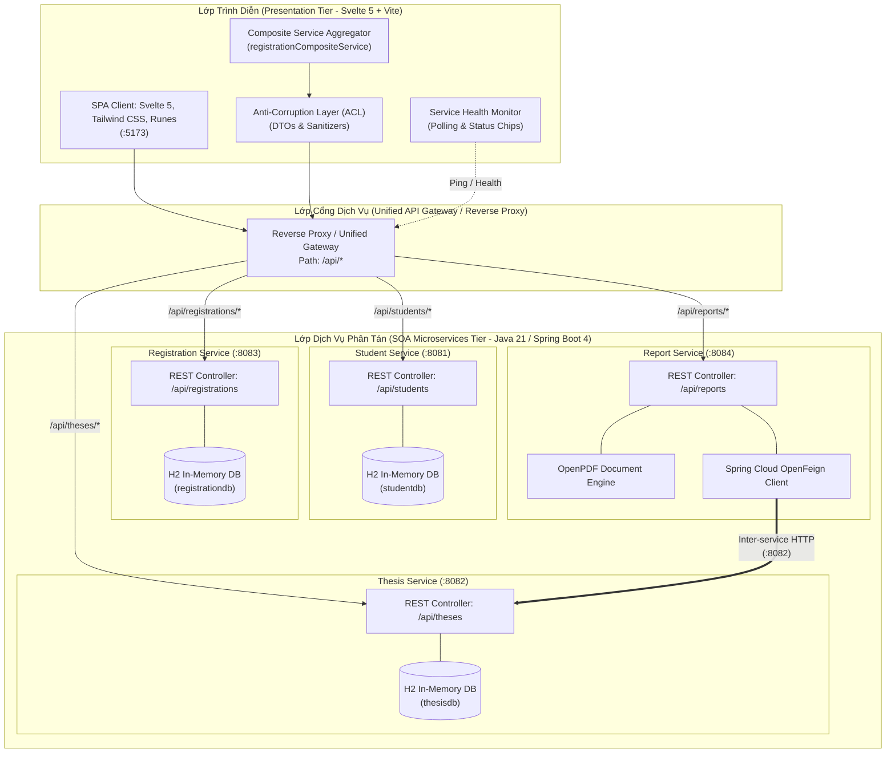

# Hệ Thống Quản Lý Đồ Án / Khóa Luận Tốt Nghiệp (Graduation Thesis Management System)

> **Kiến trúc Hướng Dịch vụ (Service-Oriented Architecture - SOA) kết hợp Thiết kế Định hướng Miền (Domain-Driven Design - DDD)**

---

## 📌 Tổng Quan Hệ Thống

Hệ thống **Quản lý Đồ án & Khóa luận Tốt nghiệp** là giải pháp phần mềm phân tán được thiết kế và hiện thực hóa dựa trên các nguyên lý chuẩn mực của **Kiến trúc Hướng Dịch vụ (SOA)** và **Domain-Driven Design (DDD)**. Hệ thống chia tách rõ ranh giới nghiệp vụ thành các dịch vụ tự chủ độc lập (*Autonomous Microservices*), giao tiếp phi trạng thái (*Stateless*), kết nối lỏng (*Loose Coupling*) và minh bạch vị trí truy cập (*Location Transparency*).

### Các phân hệ chính:
1. **Quản lý Sinh viên (`student-service`)**: Quản lý hồ sơ, lớp học, điểm trung bình tích lũy (GPA) và thẩm định điều kiện thực hiện khóa luận.
2. **Quản lý Đề tài (`thesis-service`)**: Quản lý danh mục đề tài tốt nghiệp, giảng viên hướng dẫn, giới hạn và sĩ số đăng ký của từng đề tài.
3. **Đăng ký Đề tài (`registration-service`)**: Xử lý quy trình đăng ký đề tài, phân công và kiểm soát trạng thái duyệt đơn của sinh viên.
4. **Xuất Báo cáo & Tài liệu (`report-service`)**: Dịch vụ phi trạng thái tạo tài liệu động định dạng PDF (Phiếu giao đề tài cá nhân, Bảng tổng hợp đề tài toàn khoa) thông qua giao tiếp liên dịch vụ (*Inter-service Communication*).
5. **Giao diện Người dùng (`frontend`)**: Đóng vai trò là **SOA Service Consumer** và **Composite Aggregator**, kết nối qua API Gateway thống nhất, tích hợp bảng giám sát sức khỏe dịch vụ (*Service Health Monitor*) và khả năng phục hồi lỗi từng phần (*Graceful Degradation*).

---

## 🏛️ Sơ Đồ Kiến Trúc Hệ Thống (System Architecture)



---

## 🧩 Danh Mục Dịch Vụ & Bảng Tra Cứu Cổng (Service Registry)

| STT | Tên Phân Hệ / Service | Cổng (Port) | Công Nghệ Chính | Cơ Sở Dữ Liệu | Tài Liệu Swagger UI | Giao Diện DB Console |
| :---: | :--- | :---: | :--- | :--- | :--- | :--- |
| **1** | **`student-service`** | `8081` | Spring Boot 4.1.1, Spring Data JPA, Java 21 | H2 In-Memory (`studentdb`) | [Swagger :8081](http://localhost:8081/swagger-ui/index.html) | [H2 Console :8081](http://localhost:8081/h2-console) |
| **2** | **`thesis-service`** | `8082` | Spring Boot 4.1.1, Spring Data JPA, Actuator | H2 In-Memory (`thesisdb`) | [Swagger :8082](http://localhost:8082/swagger-ui/index.html) | [H2 Console :8082](http://localhost:8082/h2-console) |
| **3** | **`registration-service`** | `8083` | Spring Boot 4.1.1, Spring Data JPA, OpenFeign | H2 In-Memory (`registrationdb`) | [Swagger :8083](http://localhost:8083/swagger-ui/index.html) | [H2 Console :8083](http://localhost:8083/h2-console) |
| **4** | **`report-service`** | `8084` | Spring Boot 4.1.1, OpenFeign, OpenPDF 2.0.3 | Phi trạng thái (Không lưu DB) | [Swagger :8084](http://localhost:8084/swagger-ui/index.html) | _(Không có)_ |
| **5** | **`frontend`** | `5173` | Svelte 5, Vite 8, Tailwind CSS v4, Vitest | Trình duyệt Client | _(Web App SPA)_ | _(LocalStorage / Cache)_ |

---

## 🎯 Tuân Thủ 8 Nguyên Lý Thiết Kế SOA (Thomas Erl)

Hệ thống được thiết kế và kiểm chứng chặt chẽ theo 8 nguyên lý SOA cốt lõi:

1. **Standardized Service Contract (Hợp đồng dịch vụ chuẩn hóa):**
   - Các dịch vụ định nghĩa rõ ràng DTO, Schema và tài liệu hóa tự động qua chuẩn OpenAPI/Swagger.
   - Frontend áp dụng các schema mapper (`student.dto.js`, `thesis.dto.js`, `registration.dto.js`) tại tầng chống ăn mòn (ACL).
2. **Service Loose Coupling (Khớp nối lỏng):**
   - Các dịch vụ hoạt động hoàn toàn độc lập, sở hữu cơ sở dữ liệu riêng biệt (Database-per-Service).
   - Frontend không gắn cứng địa chỉ vật lý của các dịch vụ, điều hướng toàn bộ qua Reverse Proxy `/api/*`.
3. **Service Abstraction (Trừu tượng hóa dịch vụ):**
   - Logic nội bộ và cấu trúc lưu trữ của từng dịch vụ được ẩn giấu hoàn toàn đằng sau các giao diện RESTful API.
4. **Service Reusability (Khả năng tái sử dụng):**
   - Dịch vụ `report-service` và các API endpoints của `thesis-service` được thiết kế chung, sẵn sàng phục vụ cho nhiều kênh tiêu thụ khác nhau (Web, Mobile, Báo cáo kiểm định).
5. **Service Autonomy (Tính tự chủ):**
   - Từng microservice có vòng đời phát triển, triển khai và khởi chạy độc lập. Nếu một dịch vụ bị dừng, các dịch vụ còn lại vẫn hoạt động bình thường.
6. **Service Statelessness (Tính phi trạng thái):**
   - Máy chủ không lưu trữ session trạng thái người dùng giữa các request, bảo đảm khả năng mở rộng quy mô linh hoạt theo chiều ngang (*Horizontal Scalability*).
7. **Service Discoverability (Khả năng khám phá dịch vụ):**
   - Hỗ trợ endpoint Health Check và Swagger Documentation giúp các dịch vụ và kỹ sư dễ dàng định danh cấu trúc API.
8. **Service Composability (Khả năng tổng hợp dịch vụ):**
   - Dịch vụ tổng hợp `registrationCompositeService` tại Frontend và Feign Client tại `report-service` hiện thực hóa mẫu hình **Composite Application Service**, phối hợp dữ liệu từ nhiều dịch vụ thành một luồng nghiệp vụ hoàn chỉnh.

---

## 📂 Cấu Trúc Thư Mục Toàn Dự Án

```text
graduation-thesis-management/
├── docs/                                  # Tài liệu kiến trúc chuyên sâu
│   └── frontend-soa-architecture.md       # Chi tiết phân tích SOA cho tầng Frontend
│
├── frontend/                              # Phân hệ Giao diện Người dùng (SOA Consumer)
│   ├── src/
│   │   ├── core/                          # Tầng nhân chia sẻ (Gateway config, HTTP Client)
│   │   ├── modules/                       # Các Domain nghiệp vụ (student, thesis, registration, report)
│   │   ├── components/                    # Thành phần giao diện dùng chung & theo module
│   │   ├── views/                         # Màn hình chính (StudentView, ThesisView, RegistrationView)
│   │   └── App.svelte                     # App Shell chính & Tab navigation
│   ├── package.json
│   └── vite.config.js
│
├── student-service/                       # Microservice Quản lý Sinh viên (:8081)
│   ├── src/main/java/com/soa/student_service/
│   │   ├── controller/                    # StudentController.java
│   │   ├── dto/                           # StudentDTO.java
│   │   ├── entity/                        # Student.java (Table: SINHVIEN)
│   │   ├── repository/                    # StudentRepository.java
│   │   └── service/                       # StudentService.java
│   ├── src/main/resources/
│   │   ├── application.properties
│   │   └── data.sql                       # 15 hồ sơ sinh viên mẫu
│   └── pom.xml
│
├── thesis-service/                        # Microservice Quản lý Đề tài (:8082)
│   ├── src/main/java/com/soa/thesis_service/
│   │   ├── config/                        # DataInitializer.java (Khởi tạo 10 đề tài mẫu)
│   │   ├── controller/                    # ThesisController.java
│   │   ├── dto/                           # ThesisRequestDto, ThesisResponseDto
│   │   ├── entity/                        # Thesis.java (Table: DE_TAI)
│   │   ├── repository/                    # ThesisRepository.java
│   │   └── service/                       # ThesisService.java
│   ├── src/main/resources/application.properties
│   └── pom.xml
│
├── registration-service/                  # Microservice Đăng ký Đề tài (:8083)
│   ├── src/main/java/com/soa/registration_service/
│   │   ├── controller/                    # RegistrationController.java
│   │   ├── dto/                           # RegistrationRequest, RegistrationResponse
│   │   ├── entity/                        # Registration.java (Table: DANGKY)
│   │   ├── repository/                    # RegistrationRepository.java
│   │   └── service/                       # RegistrationService.java
│   ├── src/main/resources/
│   │   ├── application.properties
│   │   └── data.sql                       # Dữ liệu đăng ký mẫu
│   └── pom.xml
│
├── report-service/                        # Microservice Xuất Báo cáo PDF (:8084)
│   ├── src/main/java/com/soa/report_service/
│   │   ├── client/                        # ThesisClient.java (Spring Cloud OpenFeign)
│   │   ├── config/                        # OpenApiConfig.java
│   │   ├── controller/                    # ReportController.java
│   │   ├── dto/                           # ThesisDTO.java
│   │   ├── service/                       # ReportService, PdfGeneratorService
│   │   └── util/                          # PdfFontHelper, PdfLayoutHelper
│   ├── src/main/resources/application.properties
│   └── pom.xml
│
└── README.md                              # Tài liệu hướng dẫn chung toàn hệ thống
```

---

## 📡 Chi Tiết Endpoints API Các Dịch Vụ

### 1. Student Service (`:8081`) - `/api/students`

| Phương thức | Đường dẫn | Mô tả chức năng | Dữ liệu đầu vào / Ghi chú |
| :---: | :--- | :--- | :--- |
| `GET` | `/api/students` | Lấy danh sách toàn bộ sinh viên | Trả về `List<StudentDTO>` |
| `GET` | `/api/students/{id}` | Lấy chi tiết thông tin sinh viên theo mã | `{id}` ví dụ: `SV001` |
| `POST` | `/api/students` | Thêm mới hồ sơ sinh viên | Body JSON: `StudentDTO` (`studentId`, `fullName`, `className`, `email`, `gpa`, `eligible`) |
| `PUT` | `/api/students/{id}` | Cập nhật thông tin sinh viên | Body JSON: `StudentDTO` |
| `DELETE` | `/api/students/{id}` | Xóa sinh viên khỏi hệ thống | Trả về HTTP `204 No Content` |
| `GET` | `/api/students/{id}/eligibility` | Kiểm tra điều kiện làm khóa luận | Trả về `{ studentId, eligible, gpa }` |

### 2. Thesis Service (`:8082`) - `/api/theses`

| Phương thức | Đường dẫn | Mô tả chức năng | Dữ liệu đầu vào / Ghi chú |
| :---: | :--- | :--- | :--- |
| `GET` | `/api/theses` | Lấy danh mục tất cả đề tài tốt nghiệp | Trả về `List<ThesisResponseDto>` |
| `GET` | `/api/theses/{id}` | Lấy thông tin đề tài theo mã | `{id}` ví dụ: `DT01` |
| `POST` | `/api/theses` | Tạo mới một đề tài tốt nghiệp | Body: `ThesisRequestDto` (`title`, `instructor`, `maxStudents`, `currentStudents`) |
| `PUT` | `/api/theses/{id}` | Cập nhật thông tin đề tài | Body: `ThesisRequestDto` |
| `DELETE` | `/api/theses/{id}` | Xóa đề tài tốt nghiệp | Trả về thông báo hoàn tất |
| `GET` | `/api/theses/{id}/available` | Kiểm tra đề tài còn chỗ trống hay không | Trả về `{ thesisId, available: boolean }` |
| `POST` | `/api/theses/{id}/register` | Tăng số lượng sinh viên đăng ký đề tài | Phục vụ cho `registration-service` |

### 3. Registration Service (`:8083`) - `/api/registrations`

| Phương thức | Đường dẫn | Mô tả chức năng | Dữ liệu đầu vào / Ghi chú |
| :---: | :--- | :--- | :--- |
| `GET` | `/api/registrations` | Lấy toàn bộ danh sách đăng ký đề tài | Trả về `List<RegistrationResponse>` |
| `GET` | `/api/registrations/{id}` | Lấy chi tiết một lượt đăng ký theo ID | ID số nguyên (Long) |
| `POST` | `/api/registrations` | Tạo mới lượt đăng ký đề tài | Body: `{ studentId, thesisId, status }` |

### 4. Report Service (`:8084`) - `/api/reports`

| Phương thức | Đường dẫn | Mô tả chức năng | Định dạng phản hồi |
| :---: | :--- | :--- | :--- |
| `GET` | `/api/reports/theses/{id}/pdf` | Xuất file PDF Phiếu giao đề tài cá nhân | File nhị phân `application/pdf` |
| `GET` | `/api/reports/theses/summary/pdf` | Xuất file PDF Bảng tổng hợp đề tài toàn khoa | File nhị phân `application/pdf` |
| `GET` | `/api/reports/health` | Kiểm tra tình trạng hoạt động dịch vụ | Trả về JSON `{ status: "UP", port: 8084 }` |

---

## 🚀 Hướng Dẫn Cài Đặt & Vận Hành Hệ Thống

### 1. Yêu Cầu Môi Trường (Prerequisites)
- **Java Development Kit (JDK)**: Phiên bản **Java 21 LTS** trở lên.
- **Node.js**: Phiên bản **Node 18.x** hoặc **Node 20.x LTS** trở lên.
- **Package Manager**: **`pnpm`** (Khuyên dùng) hoặc `npm`.
- **Apache Maven**: Đã được tích hợp sẵn thông qua Maven Wrapper (`mvnw` / `mvnw.cmd`) trong từng thư mục service.

---

### 2. Khởi Chạy 4 Dịch Vụ Backend (Terminal 1 - 4)

Bạn mở 4 cửa sổ terminal riêng biệt để khởi động từng microservice:

#### Cửa sổ 1: Khởi chạy `student-service`
```bash
cd student-service
# Trên Windows:
.\mvnw.cmd spring-boot:run
# Trên Linux/macOS:
./mvnw spring-boot:run
```
> Dịch vụ khởi chạy tại: **http://localhost:8081**

#### Cửa sổ 2: Khởi chạy `thesis-service`
```bash
cd thesis-service
# Trên Windows:
.\mvnw.cmd spring-boot:run
# Trên Linux/macOS:
./mvnw spring-boot:run
```
> Dịch vụ khởi chạy tại: **http://localhost:8082**

#### Cửa sổ 3: Khởi chạy `registration-service`
```bash
cd registration-service
# Trên Windows:
.\mvnw.cmd spring-boot:run
# Trên Linux/macOS:
./mvnw spring-boot:run
```
> Dịch vụ khởi chạy tại: **http://localhost:8083**

#### Cửa sổ 4: Khởi chạy `report-service`
```bash
cd report-service
# Trên Windows:
.\mvnw.cmd spring-boot:run
# Trên Linux/macOS:
./mvnw spring-boot:run
```
> Dịch vụ khởi chạy tại: **http://localhost:8084**

---

### 3. Khởi Chạy Giao Diện Người Dùng Frontend (Terminal 5)

```bash
cd frontend

# Cài đặt các gói phụ thuộc (Dependencies)
pnpm install

# Khởi chạy máy chủ phát triển Vite Development Server
pnpm dev
```
> Giao diện người dùng sẵn sàng truy cập tại: **http://localhost:5173**

---

## 🧪 Kiểm Thử Hệ Thống (Automated Testing)

### 1. Kiểm Thử Toàn Diện Tầng Frontend
Frontend được trang bị bộ kiểm thử tự động toàn diện bao gồm Unit Test cho các Dumb Components, Integration Test cho Smart Container Views và Composite Service:

```bash
cd frontend

# Chạy toàn bộ 104 bài kiểm thử tự động (Vitest)
pnpm test

# Chạy kiểm thử ở chế độ theo dõi thay đổi (Watch Mode)
pnpm test:watch

# Kiểm tra cú pháp và kiểu dữ liệu Svelte (Svelte Check - Zero Errors)
pnpm check

# Đóng gói bản phát hành sạch (Production Build)
pnpm build
```

### 2. Kiểm Thử Từng Dịch Vụ Backend
```bash
# Kiểm thử student-service
cd student-service && .\mvnw.cmd test

# Kiểm thử thesis-service
cd thesis-service && .\mvnw.cmd test

# Kiểm thử registration-service
cd registration-service && .\mvnw.cmd test

# Kiểm thử report-service
cd report-service && .\mvnw.cmd test
```

---

## 🗄️ Hướng Dẫn Truy Cập Cơ Sở Dữ Liệu H2 Console

Mỗi dịch vụ backend sở hữu một cơ sở dữ liệu độc lập chuẩn SOA. Để xem trực quan dữ liệu trong bộ nhớ:

1. **Student Database**:
   - URL: `http://localhost:8081/h2-console`
   - JDBC URL: `jdbc:h2:mem:studentdb`
   - User Name: `sa`
   - Password: `password`
2. **Thesis Database**:
   - URL: `http://localhost:8082/h2-console`
   - JDBC URL: `jdbc:h2:mem:thesisdb;DB_CLOSE_DELAY=-1`
   - User Name: `sa`
   - Password: _(để trống)_
3. **Registration Database**:
   - URL: `http://localhost:8083/h2-console`
   - JDBC URL: `jdbc:h2:mem:registrationdb;DB_CLOSE_DELAY=-1`
   - User Name: `sa`
   - Password: _(để trống)_

---

## 💡 Các Mẫu Thiết Kế (Design Patterns) Nổi Bật

- **Reverse Proxy / Unified API Gateway Pattern**: Bảo vệ cấu trúc mạng nội bộ, loại bỏ hoàn toàn vấn đề CORS và giấu kín cổng chạy thực tế của các microservice đối với trình duyệt.
- **Composite Service / Service Aggregator Pattern**: Thực thi tại `registrationCompositeService`, kết hợp dữ liệu song song từ 3 dịch vụ phân tán, đồng thời tự động ghép nối thông tin sinh viên và đề tài cho bảng đăng ký.
- **Graceful Degradation & Partial Failure Resilience**: Khi một dịch vụ ngoại vi gặp sự cố (ví dụ `student-service` hoặc `thesis-service` offline), ứng dụng vẫn hiển thị các dữ liệu còn lại một cách an toàn mà không làm sập toàn bộ giao diện.
- **Anti-Corruption Layer (ACL)**: Cách ly mô hình dữ liệu bên ngoài thông qua các hàm chuyển đổi DTO chuẩn mực (`from*Response`, `to*Payload`), bảo vệ giao diện khỏi những thay đổi bất ngờ từ cơ sở dữ liệu backend.
- **Exponential Backoff Retry**: Tự động thử lại các truy vấn mạng gặp sự cố tạm thời (502, 503, 504) với khoảng thời gian chờ tăng lũy tiến.
- **Smart Container & Dumb Component Pattern**: Phân tách rõ ràng giữa thành phần quản lý logic dữ liệu (*Smart Views*) và thành phần thuần trình diễn giao diện (*Dumb Components*).

---

## 👨‍💻 Tác Giả & Bản Quyền
- Dự án Đồ án / Khóa luận tốt nghiệp xây dựng theo tiêu chuẩn Kiến trúc Hướng Dịch vụ (SOA).
- Mọi thắc mắc hoặc đóng góp vui lòng mở Issue hoặc Pull Request trên hệ thống.
