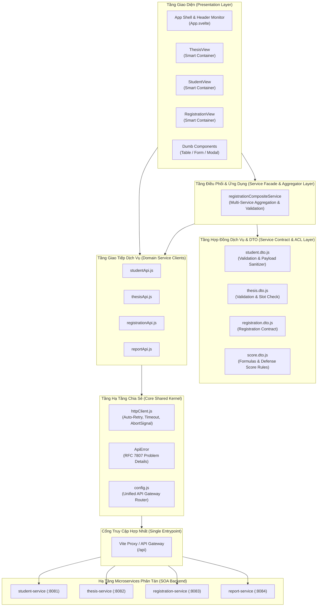

# TÀI LIỆU KIẾN TRÚC FRONTEND THEO CHUẨN SOA (SERVICE-ORIENTED ARCHITECTURE)

## HỆ THỐNG QUẢN LÝ KHÓA LUẬN TỐT NGHIỆP

---

### 1. TỔNG QUAN KIẾN TRÚC HỆ THỐNG

Hệ thống Quản lý Khóa luận Tốt nghiệp được xây dựng trên nền tảng **Kiến trúc Hướng Dịch vụ (Service-Oriented Architecture - SOA)** kết hợp tư tưởng phân tách ranh giới nghiệp vụ **Domain-Driven Design (DDD)**.

Trong hệ sinh thái SOA phân tán này:

- **Backend Services**: Các dịch vụ tự chủ độc lập (Autonomous Microservices) gồm:
  - `student-service` (Port `:8081`): Quản lý hồ sơ và điều kiện sinh viên.
  - `thesis-service` (Port `:8082`): Quản lý danh mục đề tài, giảng viên hướng dẫn và chỉ tiêu nhận sinh viên.
  - `registration-service` (Port `:8083`): Quản lý đăng ký đề tài và kết quả chấm điểm bảo vệ.
  - `report-service` (Port `:8084`): Xuất báo cáo PDF phiếu giao đề tài và bảng tổng hợp toàn khoa.
- **Frontend**: Đóng vai trò là **Service Consumer / Presentation Layer**, giao tiếp với các dịch vụ thông qua **Unified API Gateway / Reverse Proxy** và tuân thủ chặt chẽ các nguyên lý thiết kế SOA.

---

### 2. SƠ ĐỒ PHÂN TẦNG KIẾN TRÚC (LAYERED ARCHITECTURE DIAGRAM)



---

### 3. ĐỐI CHIẾU 8 NGUYÊN LÝ THIẾT KẾ SOA (THOMAS ERL'S 8 PRINCIPLES)

|  STT  | Nguyên lý SOA                                                       | Cách thức Hiện thực trong Frontend                                                                                                                                                                                                                                   |        Đánh giá        |
| :---: | :------------------------------------------------------------------ | :------------------------------------------------------------------------------------------------------------------------------------------------------------------------------------------------------------------------------------------------------------------- | :--------------------: |
| **1** | **Standardized Service Contract**<br>_(Hợp đồng dịch vụ chuẩn hóa)_ | Toàn bộ dữ liệu truyền nhận đều được định nghĩa thông qua các DTOs (`student.dto.js`, `thesis.dto.js`, `score.dto.js`, `registration.dto.js`). Mọi payload gửi lên backend và dữ liệu nhận về đều được validate và chuẩn hóa cấu trúc.                               | **Đạt chuẩn xuất sắc** |
| **2** | **Service Loose Coupling**<br>_(Khớp nối lỏng dịch vụ)_             | Frontend không phụ thuộc vào địa chỉ IP hay port của từng service. Toàn bộ kết nối điều hướng qua Gateway (`VITE_API_GATEWAY_URL=/api`). Các UI component tách biệt thành Dumb components nhận props, không phụ thuộc vào thư viện mạng.                             | **Đạt chuẩn xuất sắc** |
| **3** | **Service Abstraction**<br>_(Trừu tượng hóa dịch vụ)_               | UI hoàn toàn không biết chi tiết giao thức HTTP (Fetch, Header, AbortSignal, JSON parse). Mọi tương tác mạng được ẩn giấu sau tầng `studentApi`, `thesisApi`, `registrationApi`, `reportApi` và `httpClient`.                                                        | **Đạt chuẩn xuất sắc** |
| **4** | **Service Reusability**<br>_(Khả năng tái sử dụng dịch vụ)_         | Các API client và Service Facade được thiết kế dạng stateless module, có thể tái sử dụng ở bất kỳ view, modal hoặc tích hợp vào các client khác (Mobile App, Admin Dashboard).                                                                                       | **Đạt chuẩn xuất sắc** |
| **5** | **Service Autonomy**<br>_(Tính tự chủ của dịch vụ)_                 | Frontend hỗ trợ vận hành từng phần khi một service gặp sự cố: có component `ServiceHealthMonitor` giám sát độc lập, cơ chế `Promise.allSettled` không làm sập toàn hệ thống khi 1 service offline.                                                                   | **Đạt chuẩn xuất sắc** |
| **6** | **Service Statelessness**<br>_(Tính phi trạng thái)_                | Mọi request gửi qua `httpClient` đều mang tính phi trạng thái (RESTful). Không duy trì session bám dính trên server, sẵn sàng cho việc mở rộng tải (Horizontal Scaling).                                                                                             | **Đạt chuẩn xuất sắc** |
| **7** | **Service Discoverability**<br>_(Khả năng khám phá dịch vụ)_        | Sử dụng cơ chế phân giải Gateway đa mức độ (`isUsingGateway()`, `API_BASE` resolution), có thể tích hợp dễ dàng với Service Registry (Eureka/Consul) qua API Gateway.                                                                                                |   **Đạt chuẩn tốt**    |
| **8** | **Service Composability**<br>_(Khả năng tổng hợp/kết hợp dịch vụ)_  | Hiện thực **Composite Service Pattern** qua `registrationCompositeService`: tổng hợp dữ liệu từ 3 microservices khác nhau (`registration-service`, `student-service`, `thesis-service`) và tự động giải quyết quan hệ dữ liệu (Join) mà không làm ô nhiễm tầng View. | **Đạt chuẩn xuất sắc** |

---

### 4. CÁC MẪU THIẾT KẾ (DESIGN PATTERNS) NỔI BẬT ĐƯỢC ÁP DỤNG

1. **API Gateway / Reverse Proxy Pattern:**
   - Thay vì gọi trực tiếp 4 cổng `:8081`, `:8082`, `:8083`, `:8084`, Frontend chỉ gửi request tới `/api/*`.
   - Tránh hoàn toàn lỗi CORS, ẩn giấu cấu trúc mạng nội bộ, tăng tính bảo mật.
2. **Composite Application Service (Service Aggregator):**
   - Module `registrationCompositeService.js` tổng hợp dữ liệu từ 3 dịch vụ phân tán, xử lý lỗi từng phần (_Partial Failure Resilience_).
3. **Anti-Corruption Layer (ACL / DTOs):**
   - Các DTOs đóng vai trò lớp bảo vệ dữ liệu nội bộ của Frontend khỏi sự thay đổi mô hình dữ liệu (Schema Evolution) của Backend.
4. **Resilient Communication (Exponential Backoff Auto-Retry):**
   - Tự động thử lại khi gặp sự cố mạng tạm thời hoặc lỗi HTTP 502/503/504 với thời gian chờ tăng lũy tiến ($delay \times 2^{n}$).
5. **RFC 7807 Problem Details Standardization:**
   - Chuẩn hóa cấu trúc lỗi theo tiêu chuẩn Internet RFC 7807 (`type`, `title`, `status`, `detail`, `instance`, `timestamp`).
6. **Smart Container / Dumb Presentation Pattern:**
   - Tách biệt rõ ràng: _Smart Views_ quản lý trạng thái dữ liệu và gọi Service; _Dumb Components_ chỉ render giao diện và phát sự kiện.

---

### 5. HƯỚNG DẪN CẤU HÌNH & CHẠY HỆ THỐNG

#### Cấu hình Môi trường (`.env`)

```env
# Unified API Gateway (Chuẩn SOA - Khuyên dùng)
VITE_API_GATEWAY_URL=/api

# Khi triển khai Production với Spring Cloud Gateway:
# VITE_API_GATEWAY_URL=http://localhost:8080/api

# Hoặc khi cần debug trực tiếp từng service riêng lẻ:
# VITE_STUDENT_API_URL=http://localhost:8081/api/students
# VITE_THESIS_API_URL=http://localhost:8082/api/theses
# VITE_REGISTRATION_API_URL=http://localhost:8083/api/registrations
# VITE_REPORT_API_URL=http://localhost:8084/api/reports
```

#### Các lệnh kiểm thử & Build

```bash
# Chạy toàn bộ 125 bài kiểm thử tự động
pnpm test

# Kiểm tra kiểu và cú pháp Svelte
pnpm check

# Build bản phát hành sạch (Zero warnings, Zero errors)
pnpm build
```

---
